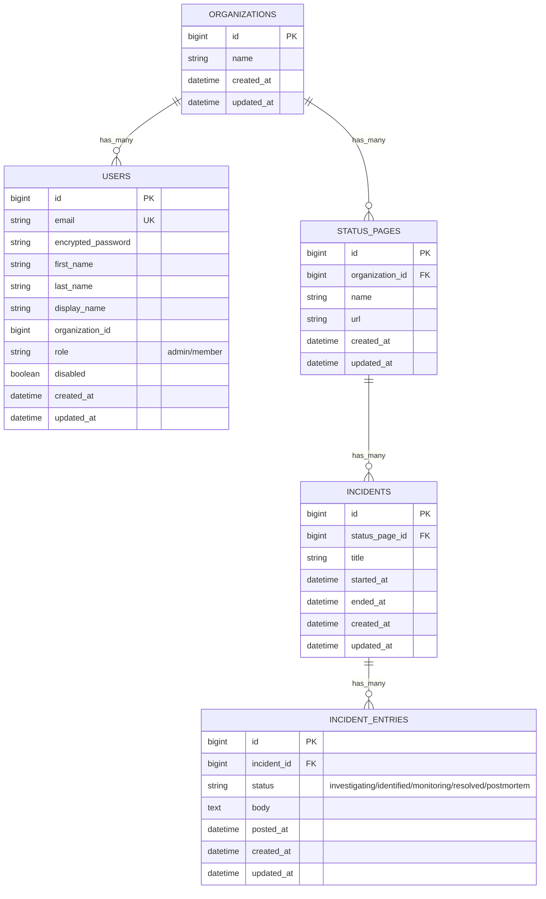

# SolidStatus

A multi-tenant B2B SaaS status page application built with Rails 8.

## Features

- **Multi-tenant architecture** with organization-based isolation
- **Role-based access control** with admin/member organization roles
- **Incident management** with timeline entries and status tracking
- **Modern UI** with Bootstrap 5, Turbo, and mobile-responsive design

## Technology Stack

- **Ruby** 4.0.6 / **Rails** 8.1.4
- **PostgreSQL** 17
- **Node.js** 26+ / **Yarn**
- **Bootstrap** 5 with SCSS
- **Turbo** for SPA-like experience
- **RSpec** with Playwright for system tests

## Development Setup

```bash
# Install dependencies and setup database
bin/setup

# Start development server with CSS watching
bin/dev

# Run tests
bundle exec rspec

# Run tests in parallel (setup required first time)
bundle exec rake parallel:setup  # Setup parallel test databases
bundle exec rake parallel:spec   # Run specs in parallel

# Code quality checks
bin/rubocop
bin/brakeman
```

## Architecture

### Database Schema



The diagram shows the business entities, not every database column or infrastructure table.
Login sessions are stored in the `sessions` table.
`users.organization_id` is required by the Rails association, but currently allows NULL and has no foreign-key constraint in the database.

### Authorization Model

1. **Organization Level**: Users belong to organizations with `admin` or `member` roles
2. **Admin Access**: Organization admins can manage status pages, incidents, and incident entries
3. **Member Access**: Organization members can view all status pages and incidents in their organization

Each user belongs to one organization through `users.organization_id`; their role is stored in `users.role`.
There is no `memberships` table in the current schema. The former table linked users to individual status pages with page-specific roles; it was removed in migration `20260824105000_remove_memberships.rb`.
Organization membership and authorization now apply across all status pages in that organization. Multi-organization membership and page-specific roles are not implemented.

### Authentication and planned changes

Authentication currently uses Devise with application-managed passwords, email confirmation, password recovery, and account locking. External authentication is not implemented.
Draft storage, explicit publish actions, and approval workflows are not implemented. The planned draft feature must keep unpublished content private to authorized users in its organization; editing and publishing will not require separate roles. Internal-only status page delivery is not planned.

## CI/CD

- **GitHub Actions** with PostgreSQL 17
- **Parallel RSpec execution** with database isolation
- **Code quality checks** (RuboCop, Brakeman)
- **Playwright system tests** with Chromium
- **Renovate** for automated dependency updates
