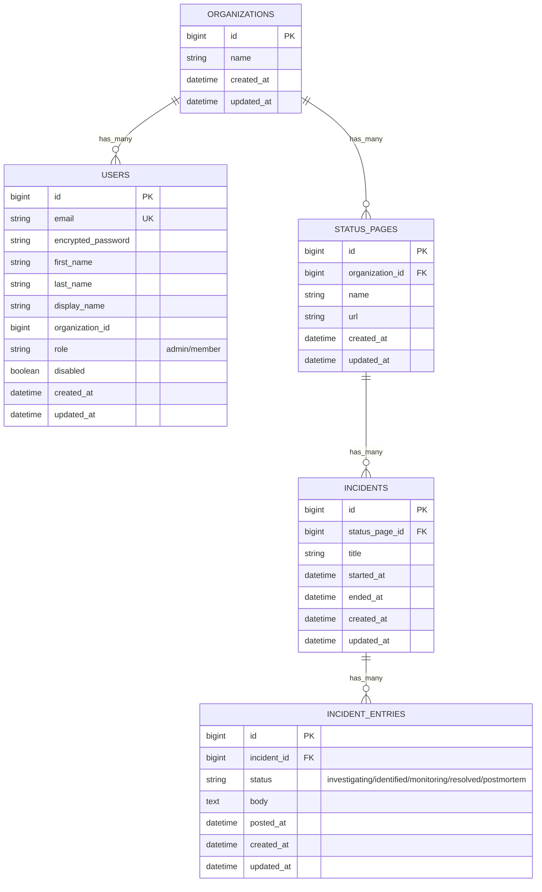

# SolidStatus

Rails 8で構築した、複数組織で利用できるB2B SaaSのステータスページアプリケーションです。

## 主な機能

- **マルチテナント構成**：組織単位でデータを分離
- **ロールベースのアクセス制御**：組織ごとに管理者（`admin`）とメンバー（`member`）を設定
- **障害管理**：障害の状態と時系列の経過報告を管理
- **ユーザーインターフェース**：Bootstrap 5とTurboを使用し、モバイル表示に対応

## 技術構成

- **Ruby** 4.0.9 / **Rails** 8.1.4
- **PostgreSQL** 17
- **Node.js** 26.12.1 / **Yarn**
- **Bootstrap** 5とSCSS
- **Turbo**によるSPAに近い画面遷移
- **RSpec**とPlaywrightによるシステムテスト

## 開発環境のセットアップ

```bash
# 依存関係のインストールとデータベースの準備
bin/setup

# CSSの変更を監視しながら開発サーバーを起動
bin/dev

# テストを実行
bundle exec rspec

# テストを並列実行（初回はテスト用データベースの準備が必要）
bundle exec rake parallel:setup  # 並列テスト用データベースを準備
bundle exec rake parallel:spec   # テストを並列実行

# コード品質とセキュリティの検査
bin/rubocop
bin/brakeman
```

## アーキテクチャ

### データベース構成



この図は主要な業務データの構成を示しており、すべてのカラムや基盤用テーブルを網羅しているわけではありません。
ログインセッションは `sessions` テーブルに保存します。
`users.organization_id` はRailsの関連付けでは必須ですが、現在のデータベースではNULLを許容し、外部キー制約もありません。

### 権限モデル

1. **組織への所属**：ユーザーは一つの組織に所属し、`admin` または `member` のロールを持ちます。
2. **管理者の権限**：組織の管理者は、その組織のステータスページ、障害情報、経過報告を作成、更新、削除できます。
3. **メンバーの権限**：組織のメンバーは、その組織のすべてのステータスページと障害情報を閲覧できます。

ユーザーの所属先は `users.organization_id`、ロールは `users.role` に保存します。
現在のスキーマに `memberships` テーブルはありません。
以前はユーザーと個別のステータスページを結び付け、ページごとのロールを管理していましたが、マイグレーション `20260824105000_remove_memberships.rb` で削除しました。

現在は組織への所属と権限を、その組織のすべてのステータスページに適用します。
複数組織への所属や、ページごとの権限設定は実装していません。

### 認証と今後の機能

現在の認証にはDeviseを使用し、アプリケーション内でパスワード管理、メールアドレス確認、パスワード再設定、アカウントロックを行います。
外部認証は実装していません。

下書きの保存、明示的な公開操作、承認フローは実装していません。
計画中の下書き機能では、未公開の内容を組織内の権限を持つユーザーだけが閲覧できるようにし、編集者と公開者のロールは分けない予定です。
社内限定のステータスページ配信機能は予定していません。

## CI/CD

- **GitHub Actions**とPostgreSQL 17を使用
- **RSpecの並列実行**では、テスト用データベースを分離
- **RuboCopとBrakeman**によるコード品質とセキュリティの検査
- **ChromiumとPlaywright**によるシステムテスト
- **Renovate**による依存関係の自動更新
